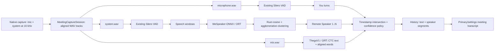

# Local speaker diarization for ThegaV1 meetings

Status: research only. No production feature was implemented.
Scope: dev worktree inspected on 2026-08-03. Every recommended inference step is local and offline.

## Recommendation

Build a track-aware pipeline in Rust: existing Silero VAD identifies speech, an ONNX speaker-embedding model produces vectors through the existing ort runtime, and Rust agglomerative clustering labels remote speakers. Treat microphone and system tracks as a hard coarse separation first: microphone activity is You; cluster only the system track for Remote Speaker 1, Remote Speaker 2, and so on. Recover word timing from the ThegaV1 CTC emissions already computed by MalayalamAsr, then intersect words with those diarization turns.

This is the best fit for MASR. It adds no cloud API or Python/PyTorch runtime, reuses 16 kHz audio, ONNX Runtime, and Silero VAD, and supplies a useful answer even before fine remote diarization succeeds: was this speech from the local user or a remote participant?

The initial embedding candidate is the official [Wespeaker ResNet34 ONNX repository](https://huggingface.co/Wespeaker/wespeaker-voxceleb-resnet34/tree/main). It contains a 26.5 MB ONNX file and the repository label is Apache-2.0. The publisher's ONNX example specifies the exact 16 kHz, 80-bin Kaldi fbank and CMN preprocessing required. Before distribution, perform a license/notice audit: WeSpeaker's general pretrained-model documentation says VoxCeleb-trained models follow CC-BY-4.0. Both licenses permit redistribution, but MASR should include the stricter attribution/notice set unless the publisher resolves the discrepancy. [Model files and license](https://huggingface.co/Wespeaker/wespeaker-voxceleb-resnet34/tree/main), [WeSpeaker license guidance](https://github.com/wenet-e2e/wespeaker/blob/master/docs/pretrained.md), [ONNX preprocessing example](https://raw.githubusercontent.com/wenet-e2e/wespeaker/master/wespeaker/bin/infer_onnx.py).

Use pyannote Community-1 as an offline quality reference, not the initial shipping integration. It can run locally after download and has useful exclusive diarization output, but it adds Python/PyTorch and its model download is gated behind user/contact acceptance. [pyannote Community-1 model card](https://huggingface.co/pyannote/speaker-diarization-community-1).

## Verified repository findings

| Area | Verified behaviour on dev | Consequence |
| --- | --- | --- |
| ThegaV1 ASR | MalayalamAsr creates 16 kHz log-mel features, executes ORT, greedily argmax-decodes CTC logits, and returns only a String in src-tauri/src/malayalam_asr.rs lines 57-256. | The timing information exists transiently but is discarded. |
| Result type | Both ThegaV1 paths wrap that text in a TranscriptionResult with an empty segments vector in managers/transcription.rs lines 903-911 and 1263-1269. | There is no transcript time axis to join to a diarizer. |
| Meeting ASR contract | MeetingAction::stop waits for, loads, and transcribes with thegav1, then restores the selected model in actions.rs lines 1416-1461. | Preserve ThegaV1 for meeting ASR; diarization is a parallel local stage, not a replacement model. |
| Track persistence foundation | MeetingCaptureSession can atomically persist aligned 16 kHz mono microphone.wav, system.wav, and mix.wav with silence padding; HistoryEntry has typed AudioTracks. | This is the right storage contract for source-aware diarization. |
| Active meeting capture | The actual meeting action calls stop_recording for one vector and saves one thegai WAV. AudioRecordingManager starts the microphone recorder only. | The supplied three-track premise is storage infrastructure, not a completed active capture flow. Aligned mic/system capture is a prerequisite. |
| Runtime | Cargo already contains ort, ndarray, hound, rustfft, and vad-rs. MalayalamAsr deliberately uses the default CPU ORT session. | A second local ONNX session is a natural fit, but it needs its own correct preprocessing. |
| History/UI | HistoryEntry has plain transcription_text and optional audio_tracks but no timed/speaker segments. The primary and settings meeting views render the plain text. | Speaker turns need nullable persistence and UI rendering while retaining plain transcript compatibility. |

The active-flow discrepancy is material: do not claim source separation until native capture adapters feed MeetingCaptureSession and MeetingAction finalizes its AudioTracks. The source presently has a durable track writer but not an end-to-end use of it.

## What the tracks make possible

The microphone and system tracks create a valuable prior.

- VAD speech in microphone.wav can be called You without voice recognition.
- VAD speech in system.wav is a remote/system source. Embeddings can further cluster non-overlapping remote turns into meeting-local Speaker 1, Speaker 2 labels.
- mix.wav remains the compatible playback and ASR input, and is the only fallback for older entries without AudioTracks.

This is source attribution, not source separation. Conferencing software has already mixed all remote people into system.wav, so concurrent remote speakers remain mixed. A diarizer can identify overlap, but ThegaV1 produces a single CTC transcript stream and cannot truthfully generate two separate texts for one interval. Display Multiple or Unknown, never invented speaker text. Headphones improve the source assumption; playback/mic echo should lower confidence rather than override a physical source label.

## Candidate approaches

| Candidate | Local after model install? | Fit | Assessment |
| --- | --- | --- | --- |
| A. Track-aware Silero VAD + WeSpeaker ONNX + Rust clustering | Yes | Uses existing ORT and VAD directly | Recommended. |
| B. Track-only source attribution | Yes | No new model, but needs real system capture | Useful staged fallback: You versus Remote only. |
| C. pyannote segmentation + embedding + clustering, ported/exported to ONNX | Potentially | ORT-compatible in principle | Research candidate. Export operators, preprocessing, and thresholds must be reproduced and validated. |
| D. pyannote Community-1 via Python | Yes after download | Adds Python, PyTorch, gated acquisition | Best local baseline, not the product runtime. |
| E. Sherpa-ONNX Rust diarization | Yes | Rust and all desktop OSes, but introduces another native speech stack | Viable contingency, not preferred. |
| F. SpeechBrain ECAPA exported to ONNX | Yes after MASR-owned export | 89.1 MB PyTorch source artifact | Permissive fallback, less direct than published WeSpeaker ONNX. |

### A. Recommended VAD, embedding, and clustering pipeline

1. Run existing Silero VAD separately on microphone.wav and system.wav. Merge small gaps, reject very short fragments, and retain meeting-clock time. VAD means speech exists; it does not identify a speaker. Silero supports compact 16 kHz ONNX use. [Silero model history](https://github.com/snakers4/silero-vad/wiki/Version-history-and-Available-Models)
2. Convert qualifying microphone activity to local_user, display label You. Do not cluster local and remote audio together in the first version.
3. Cut system VAD intervals into fixed overlapping windows. A sensible feasibility start is 2.0-second windows with a 1.0-second hop; this matches the 200-frame, 10 ms training configuration. Ignore or pad a short tail according to the audited model contract.
4. Extract and L2-normalize 256-dimensional WeSpeaker embeddings. The upstream ONNX reference takes feats with shape batch by time by 80, uses 25 ms Hamming-window Kaldi fbank with a 10 ms shift, then mean-only CMN. MASR's MalayalamAsr feature extractor is different: centered STFT, Slaney mel, pre-emphasis, and variance normalization. Reuse ORT, not ThegaV1's feature tensor. [WeSpeaker config](https://huggingface.co/Wespeaker/wespeaker-voxceleb-resnet34/raw/main/config.yaml), [reference preprocessing](https://raw.githubusercontent.com/wenet-e2e/wespeaker/master/wespeaker/bin/infer_onnx.py)
5. Calculate cosine distances and use average-linkage agglomerative clustering with a corpus-calibrated threshold. Rust can own this part; [kodama](https://docs.rs/kodama/latest/kodama/) is a fast agglomerative implementation and [linfa-clustering](https://docs.rs/linfa-clustering/latest/linfa_clustering/) supplies pure-Rust density/K-means alternatives.
6. Smooth labels using a minimum turn duration and short-gap merge. Number clusters deterministically by first audible turn in that meeting. They are not identities across meetings.
7. Intersect the final source/speaker turns with ThegaV1 words. Coalesce consecutive equal labels for display and preserve Unknown or Multiple when coverage is weak or speech overlaps.

### B. Track-only attribution

This should be the degradation path of A. With no embedding model it still makes a defensible distinction between local and remote speech for non-overlap. It is not multi-person diarization within system.wav. It must not be enabled until track capture is continuous, aligned, and reports system-audio availability honestly.

### C/D. pyannote alternatives

The MIT-licensed [pyannote segmentation-3.0 model](https://huggingface.co/pyannote/segmentation-3.0/blob/refs%2Fpr%2F4/LICENSE) could be combined with WeSpeaker embeddings and Rust clustering after a MASR-owned ONNX export. It may improve boundary/overlap handling, but it is not a published ORT drop-in. A spike must pin a revision, inspect unsupported operators, reproduce source outputs, and calibrate thresholds.

[pyannote Community-1](https://huggingface.co/pyannote/speaker-diarization-community-1) is CC-BY-4.0, runs on CPU by default, supports offline disk loading, and returns exclusive speaker diarization specifically intended to reconcile transcript timestamps. Access requires accepting conditions and sharing contact information, and normal use needs pyannote.audio/PyTorch. Use it locally on consented, held-out audio as a baseline only. Never use a hosted precision pipeline because that violates the local-only constraint.

### E/F. Rust-native alternatives

[Sherpa-ONNX](https://github.com/k2-fsa/sherpa-onnx) advertises local speaker diarization, a Rust API, and Windows/macOS/Linux support under an Apache-2.0 code license. It is credible if a turnkey maintained diarizer matters more than reuse of MASR ORT sessions. It would add a second native stack, and every selected model asset still needs a separate license check.

No small mature pure-Rust neural diarizer was found. The proper Rust-native boundary is WAV processing, cosine distance, clustering, smoothing, persistence, and UI types. ONNX Runtime remains the neural inference boundary. SpeechBrain's [ECAPA model card](https://huggingface.co/speechbrain/spkrec-ecapa-voxceleb/tree/main) labels its 89.1 MB PyTorch repository Apache-2.0; converting it to ONNX would make MASR responsible for preserving model equivalence and preprocessing.

## Closing the ThegaV1 timestamp gap

MalayalamAsr already creates time-major logits before decoding. Replace its internal string-only outcome with an MASR-owned result, while retaining a text compatibility wrapper:

    MalayalamAsrResult {
      text: String,
      words: Vec<AlignedWord>, // text, start_s, end_s, confidence
      output_frame_count: usize,
      timing: Measured | Approximate,
    }

Retain each non-blank greedy CTC run as token ID, output start frame, output end frame, and optional logit margin. Use the existing SentencePiece boundary token to group token spans into words, retaining punctuation with the previous word. The final transcript text remains unchanged.

The input hop is 160 samples at 16 kHz, so feature frames are approximately 10 ms apart. Do not assume CTC output frames are 10 ms apart: the Conformer may subsample input features and has a receptive-field offset. Measure the actual ratio of input frames to output logits and calibrate onset/offset with controlled audio from the exact shipped thegav1 archive. Until that succeeds, duration divided by output-frame count is only an explicit approximation.

For a final transcript, a small Rust Viterbi CTC forced-alignment pass over the same log-softmax emissions is preferable to argmax-run edges. It aligns the known decoded token sequence without another ASR model or any cloud call. CTC forced-alignment tooling represents tokens as start-inclusive/end-exclusive emission-frame spans; MASR can implement the same algorithm locally. [TokenSpan](https://docs.pytorch.org/audio/stable/generated/torchaudio.functional.TokenSpan.html), [alignment walkthrough](https://docs.pytorch.org/audio/main/tutorials/ctc_forced_alignment_api_tutorial.html).

For each aligned word interval, intersect it with local and remote turns. Assign the dominant label only if it covers a calibrated fraction of the word, such as an experimental 60 percent starting point. Preserve Multiple for credible concurrent source activity and Unknown when coverage is weak. Combine neighbouring same-label words into display segments.

## Target architecture

Every component after model installation is local file, memory, or in-process computation. Model setup can use MASR's existing artifact downloader, but inference must make no HTTP call or require credentials.

## Later implementation map

| Location | Later work | Guardrail |
| --- | --- | --- |
| managers/audio.rs and native adapters | Create a meeting capture coordinator for mic and system frames on one 16 kHz clock. | Implement WASAPI loopback, ScreenCaptureKit, and PipeWire/PulseAudio behind one contract; disclose unavailability. |
| managers/meeting_capture.rs | Reuse MeetingCaptureSession and expose finalized AudioTracks. | Keep it as the sole persistence layer. |
| malayalam_asr.rs | Retain CTC token spans and return MalayalamAsrResult. | Calibrate output stride; preserve text compatibility. |
| managers/transcription.rs | Populate timing for ThegaV1 instead of an empty segments vector. | Do not overload transcribe-rs segment text with speaker names. |
| New managers/diarization.rs | Own VAD iteration, WeSpeaker fbank, ORT session, clustering, smoothing, and diagnostics. | Keep feature-specific flow in a manager, not a parallel recording state. |
| actions.rs | Finalize tracks then run ASR on mix and diarization on source tracks in bounded blocking tasks. | Keep thegav1 forced-load/restore behaviour. Thread-budget ASR and embedding work. |
| managers/history.rs | Add nullable JSON speaker_segments and a migration; update retry/delete/retention paths. | Keep plain transcription_text for old records, summaries, copy, and search. |
| managers/model.rs | Add a separately typed optional diarization asset catalog entry using existing checksum/download/extract flow. | Do not make it an EngineType selectable ASR model or include it in first-run ASR setup. |
| settings.rs and store | Add an opt-in local diarization setting and asset status. | No API key or cloud setting. |
| specta path and bindings | Export new types through the existing generation path. | Never hand-edit src/bindings.ts. |
| MeetingsView and MeetingsSettings | Render speaker rows/badges, time, source and uncertainty; provide unlabelled fallback. | Plain-text copy remains default; keep English-only translations. |

Retry is important. Current retry re-transcribes a single WAV. It must use retained AudioTracks to rerun diarization or explicitly clear stale labels; never keep old labels for a new transcript.

## Distribution, performance, and platform plan

Use the existing model catalog mechanism for a separately typed optional asset: pinned source, SHA-256, progress, extraction, and manifest. Keep it out of automatic first-run ASR selection. The model manifest must retain upstream revision, input contract, byte size, checksum, license/data notices, and any conversion source. Provide an offline installer path for air-gapped users.

The official WeSpeaker normal ResNet34 repository contains a 26.5 MB ONNX file and 71.6 MB total listed files. SpeechBrain ECAPA is 89.1 MB and PyTorch. A public mirror lists pyannote Community-1 around 33.7 MB, but MASR should only acquire it through its upstream gated terms if ever used. Do not ship an arbitrary third-party conversion unless MASR owns its conversion, validation, and provenance.

CPU is the portable baseline. ThegaV1 already has an 859 MB model catalog entry; the embedding file is small on disk but actual peak RSS depends on ORT allocations, fbank buffers, and concurrency. Process one window at a time, retain only timestamps plus 256 float normalized vectors, and release raw/fbank buffers immediately.

Do not claim a desktop real-time factor or memory number without measuring the exact pipeline. Release gates should measure peak RSS and wall time on 30- and 60-minute consented Malayalam/code-switching meetings with ThegaV1 loaded, source attribution accuracy, remote-cluster quality, and UI responsiveness. ONNX Runtime supports providers including CUDA, DirectML, and CoreML, but usable support depends on the packaged ORT build and the model graph. CPU remains the supported design until each provider passes packaging, output-parity, and performance tests. [ORT execution providers](https://onnxruntime.ai/docs/execution-providers/).

## Validation before feature approval

1. Capture: verify equal sample counts, 16 kHz headers, silence padding, cancellation cleanup, and system-audio status on all three desktop OSes.
2. ASR timing: use known beep/speech fixtures to record feature count, logit count, CTC token spans, stride, and offset; compare argmax spans to Viterbi alignment.
3. Embedding parity: compare MASR Rust preprocessing and normalized embeddings against the publisher's ONNX reference on fixed WAV fixtures.
4. Corpus: use consented Malayalam and code-switched meetings with local/remote, multiple remote speakers, silence, overlap, headphones, and speaker leakage.
5. Metrics: report source attribution separately from remote clustering and speaker-turn error; an aggregate score hides the benefit of tracks.
6. Offline guard: disable networking after install and assert no diarization path opens HTTP or requires credentials.
7. Persistence/UI: test old history migration, retry, deletion/retention, generated bindings, both meeting views, screen-reader labels, and plain/labelled copy.

## Risks and open questions

- Native system capture is the first blocker. A durable track writer is not a working WASAPI, ScreenCaptureKit, or PipeWire adapter.
- ThegaV1 output stride and timing offset are unverified. Input hop is 10 ms; output CTC timing must be measured.
- System audio is still a remote mix. Overlap and echo limit source and speaker attribution; preserve uncertainty.
- Malayalam and code-switching embedding calibration needs evidence, even if the speaker model is designed to be language-robust.
- Model/data license provenance needs a release gate, not only a Hub badge.
- Speaker labels are meeting-local clusters. Cross-meeting voiceprints need a separate explicit privacy/consent design.
- ASR and embedding inference can compete for CPU. Serialize or budget threads.

## Sources

- [WeSpeaker pretrained models, ONNX support, and license guidance](https://github.com/wenet-e2e/wespeaker/blob/master/docs/pretrained.md)
- [Official WeSpeaker ResNet34 ONNX model](https://huggingface.co/Wespeaker/wespeaker-voxceleb-resnet34/tree/main)
- [Official WeSpeaker ONNX inference example](https://raw.githubusercontent.com/wenet-e2e/wespeaker/master/wespeaker/bin/infer_onnx.py)
- [pyannote Community-1 local/offline and licensing information](https://huggingface.co/pyannote/speaker-diarization-community-1)
- [pyannote segmentation-3.0 license](https://huggingface.co/pyannote/segmentation-3.0/blob/refs%2Fpr%2F4/LICENSE)
- [Sherpa-ONNX offline diarization and Rust support](https://github.com/k2-fsa/sherpa-onnx)
- [SpeechBrain ECAPA model size and license label](https://huggingface.co/speechbrain/spkrec-ecapa-voxceleb/tree/main)
- [CTC forced-alignment mechanics](https://docs.pytorch.org/audio/main/tutorials/ctc_forced_alignment_api_tutorial.html)
- [ONNX Runtime execution providers](https://onnxruntime.ai/docs/execution-providers/)
- [Rust agglomerative clustering](https://docs.rs/kodama/latest/kodama/)

